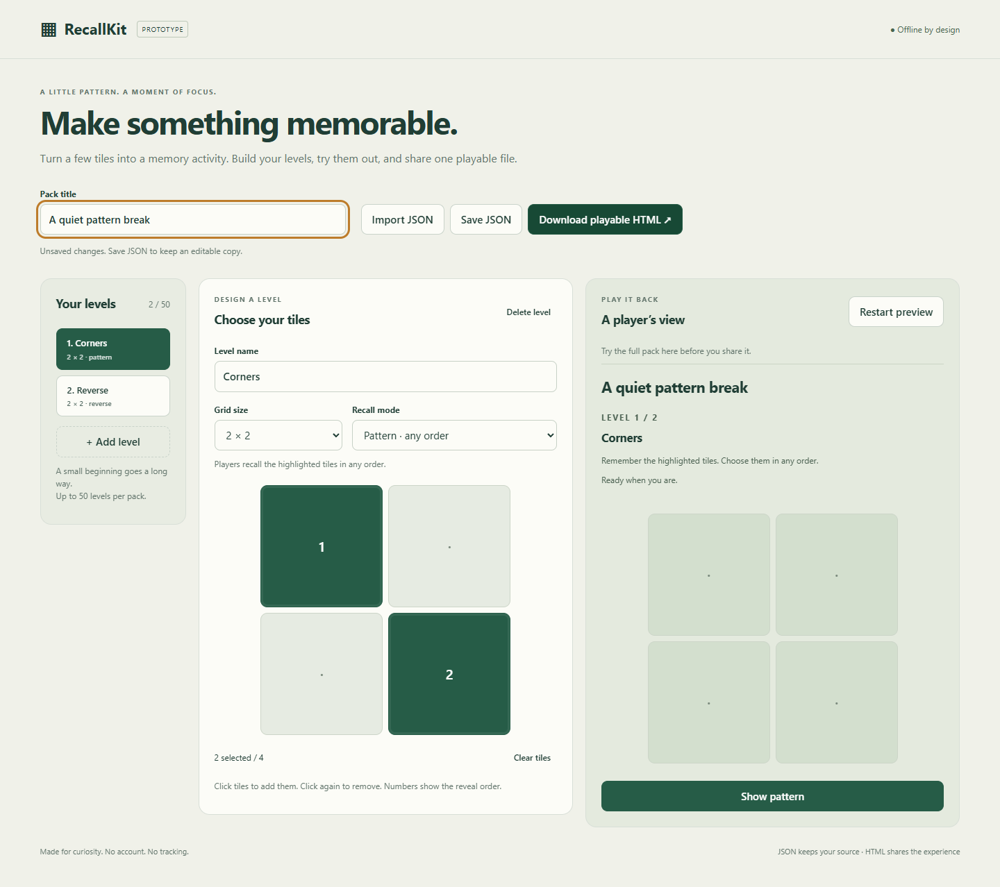

# RecallKit — offline authoring prototype

[Download the free prototype](https://github.com/CinEmin/recallkit/releases/tag/v0.1.0-prototype) · [Report a playtest](https://github.com/CinEmin/recallkit/issues/new?template=playtest.yml)

A dependency-free visual editor for small memory-pattern activities. No network, account, analytics, payments, storage requirement, or efficacy claims. Product name is provisional. Paid demand has not been validated.

Open `index.html` directly in a modern browser. All editor files must stay together. Alternatively serve this directory locally with `python -m http.server 8766 --bind 127.0.0.1` and open `http://127.0.0.1:8766/`.

1. Name your pack. Edit, add, or delete levels; at least one level must remain.
2. Choose a 2–6 square grid and pattern, sequence, or reverse recall mode.
3. Click tiles to add them in order. Click selected tiles to remove them. Reducing grid size drops indices outside the new grid.
4. Preview the pack: **Show pattern**, study it, then **Hide & recall**. Reveal time is deliberately self-paced. A wrong response allows unlimited retries.
5. **Save JSON** downloads the editable source. Work is held only in this tab; closing or reloading can lose unsaved work. **Import JSON** replaces the current pack only when validation succeeds.
6. **Download playable HTML** creates one standalone file, including styles, data, and player. Open or share that file; it needs no companion assets or connection. Keep JSON separately for editing.

JSON schema: `{ "version": 1, "title": "My pack", "levels": [{ "name": "First", "size": 3, "mode": "sequence", "tiles": [0,4,8] }] }`. Tile indices are zero-based, row-major, ordered and unique. Titles/names must contain 1–80 characters, with non-whitespace content. 1–50 levels; each needs at least one tile. Imports are limited to 64 KiB UTF-8; unknown fields are discarded. Invalid imports preserve the current pack. Edits reset preview immediately; there are no delayed reveal callbacks.

From the source repository directory, run `node --test tests/*.test.cjs`. Tests are included in the source repository, not the smaller end-user ZIP. Browser acceptance is a separate check, not claimed by the Node suite.

Stable browser selectors: `#pack-title`, `#level-name`, `#grid-size`, `#mode`, `#editor-grid [data-tile="0"]`, `#add-level`, `#delete-level`, `#level-list [data-level="0"]`, `#clear-tiles`, `#import-file`, `#export-json`, `#export-html`, `#message`. Preview: `#preview #player-action`, `#preview #player-grid [data-tile="0"]`. Exported player: `#player-action`, `#player-grid [data-tile="0"]`, `[role="status"]`.

Core API: `RecallKit.normalize(pack)`, `parse(jsonText)`, `matches(level, indices)`, `serialize(pack)`, `exportHTML(pack)`, and `mountPlayer(container, pack, matches)`; CommonJS exports provide the same API for Node tests. No build step or external dependencies.

Verified in Microsoft Edge on Windows at1440px and390px: authoring, JSON roundtrip, failed import preservation, standalone offline play/retry, inert script-like titles and no HTTP(S) requests. Other browsers, physical touch devices and target-customer usability are not yet verified. This is a free evaluation prototype, not a finished paid product or a proven business.

## Try the prototype

Download the ZIP from [Releases](https://github.com/CinEmin/recallkit/releases), extract it, and open `index.html`. Create two levels of your own, save the JSON, export playable HTML, then open the exported file in another browser tab. The `samples` folder contains an example editable pack and its standalone player.

If you choose to give feedback, [open a playtest report](https://github.com/CinEmin/recallkit/issues/new?template=playtest.yml). Reports are public: do not include personal information, credentials, proprietary content or private files. Tell us whether you completed the task without assistance, where you got stuck, and which tool you would otherwise use. Download counts are not measured usability or purchase intent.

Code and interface text were created with AI assistance. No third-party code, images or audio assets are bundled. The prototype has no checkout, subscription or promised future feature set.

## Who this experiment is for

Independent creators who want to make a short, custom memory-pattern activity without changing source code. Create a grid, pick tiles in order, choose the recall rule, then export a file someone else can open. It does not generate a full game campaign, collect player results or sync across devices. This experiment tests whether that small authoring workflow is useful.

## Prefer to play a ready-made activity?

[LoopLab Memory Journey](https://looplab-pilot.racing-thyme-8277.chatgpt.site/) offers 15 untimed levels directly in a browser, with free hints and retries. It is a separate game, not a viewer for RecallKit files. LoopLab has optional consent-based analytics; RecallKit's offline editor and exports have none. [LoopLab source and details](https://github.com/CinEmin/looplab).
